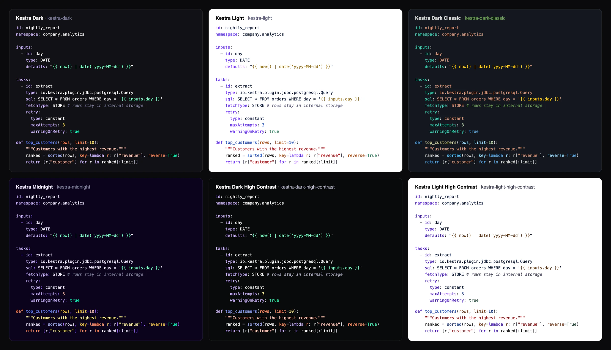
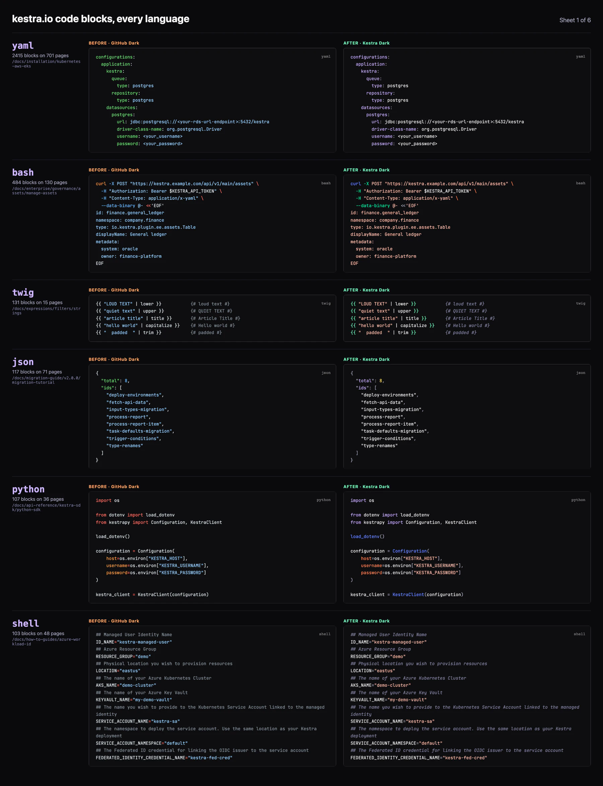
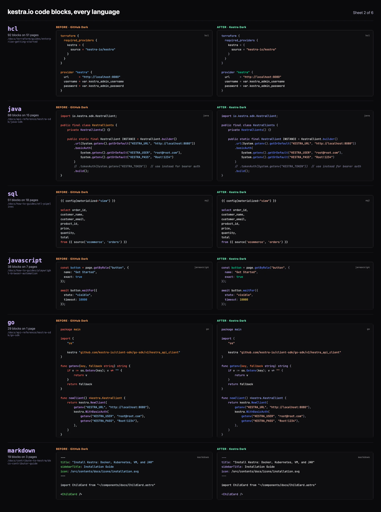
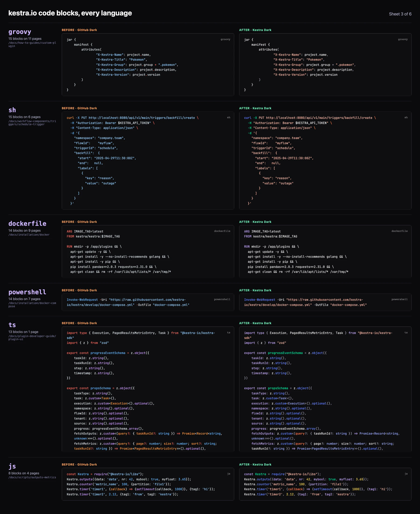
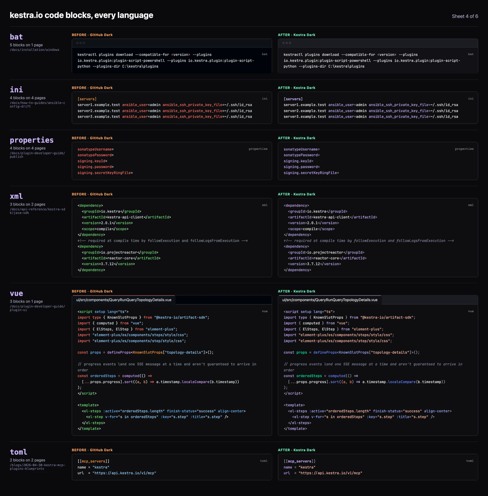
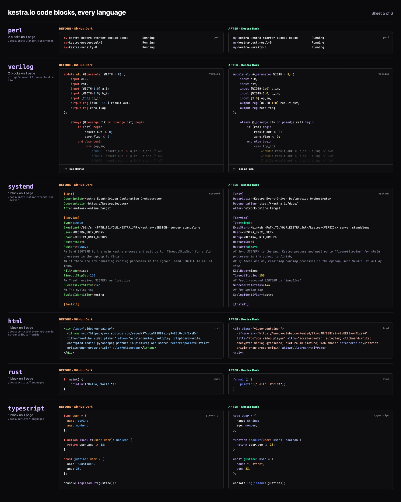
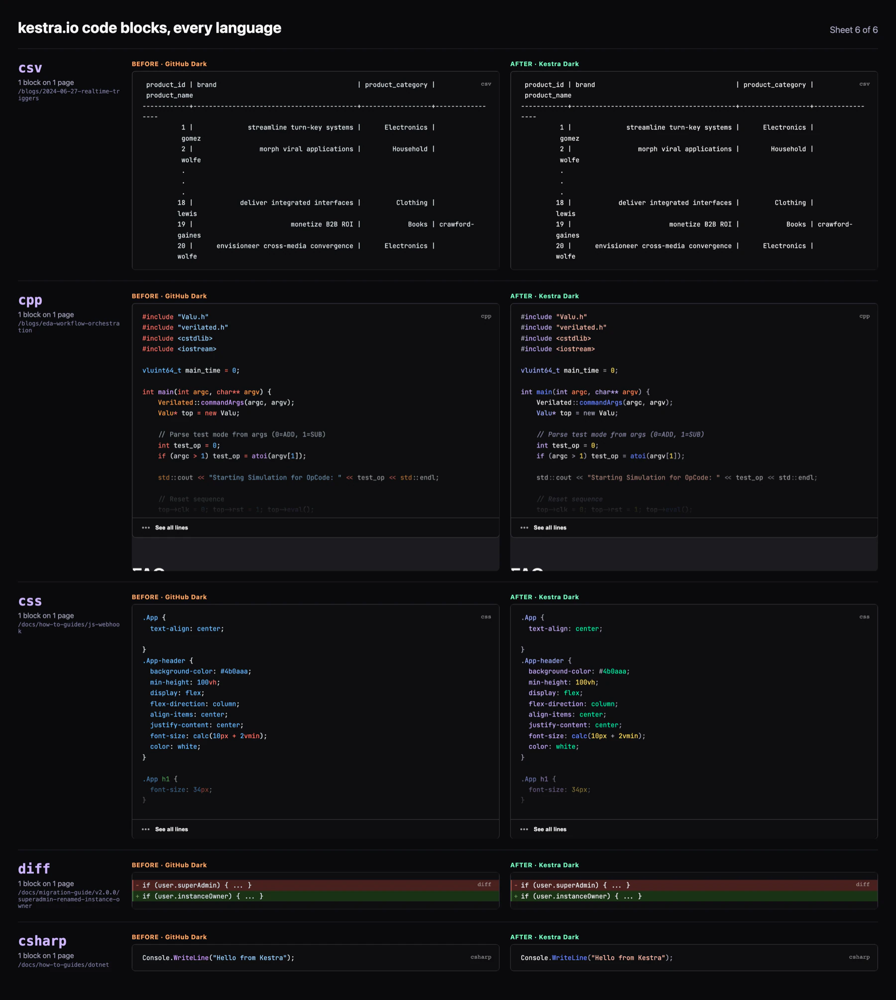

<h1 align="center">@kestra-io/plumage</h1>

<p align="center"><i>A kestrel's plumage is its colors. This is Kestra's, for code.</i></p>

<p align="center">
  The syntax themes of Kestra. One set of colors for the flow editor, the in-app docs, kestra.io and VS Code,<br>
  with Pebble highlighting for YAML and real highlighting for the code a flow holds.
</p>

<p align="center">
  
</p>

## What you get

- Six themes built from the Kestra design system palette, including the Dark 2.0 editor design and two high contrast themes.
- One theme definition, many targets: a Monaco theme for KsEditor, a TextMate theme for Shiki and Expressive Code, and a VS Code extension.
- Pebble `{{ }}` and `` blocks painted in their own color in YAML, in the app and on the docs site alike.
- Tests that hold every color to WCAG contrast and keep function names and parameters visibly apart from plain text.
- No runtime dependencies. Expressive Code is an optional peer, only needed for its plugin.

## Contents

- [Themes](#themes)
- [Every language on kestra.io](#every-language-on-kestraio)
- [Install](#install)
- [Usage](#usage): [Monaco](#monaco) · [Pebble in Monaco](#pebble-in-monaco) · [Shiki](#shiki) · [Expressive Code](#expressive-code-astro) · [VS Code](#vs-code)
- [API](#api)
- [Syntax roles](#syntax-roles)
- [How Pebble is found](#how-pebble-is-found)
- [Where Kestra uses it](#where-kestra-uses-it)
- [Adding or changing a theme](#adding-or-changing-a-theme)
- [Performance](#performance)
- [What the tests check](#what-the-tests-check)
- [Development](#development)
- [Publishing](#publishing)

## Themes

| Theme | Name | Kind | Based on |
|---|---|---|---|
| Kestra Dark | `kestra-dark` | dark | The Dark 2.0 editor design: lavender keys, white values, mint Pebble |
| Kestra Light | `kestra-light` | light | KsEditor's light theme |
| Kestra Dark Classic | `kestra-dark-classic` | dark | KsEditor's previous dark theme (Monaco `vs-dark` on the Kestra surface) |
| Kestra Midnight | `kestra-midnight` | dark | Brand violet background, coral keywords |
| Kestra Dark High Contrast | `kestra-dark-high-contrast` | dark, high contrast | Every role at 7:1 or more |
| Kestra Light High Contrast | `kestra-light-high-contrast` | light, high contrast | Every role at 7:1 or more |

Kestra Dark and Kestra Light are the defaults: the app uses them when the editor follows the app theme, and the docs site uses them for every code block.

<details>
<summary><b>Key colors of each theme</b></summary>

| Role | Dark | Light | Dark Classic | Midnight | Dark High Contrast | Light High Contrast |
|---|---|---|---|---|---|---|
| Background | `#111115` | `#FFFFFF` | `#14181F` | `#0B021C` | `#08090A` | `#FFFFFF` |
| Keys | `#CDB6FB` | `#631BF3` | `#3DC9B0` | `#CDB6FB` | `#CDB6FB` | `#440AB8` |
| Values | `#F7F7F8` | `#001233` | `#CE9178` | `#EEE7FE` | `#FFFFFF` | `#001233` |
| Pebble | `#80FAC5` | `#8F6A00` | `#FFCA16` | `#80FAC5` | `#80FAC5` | `#5C3209` |
| Keywords | `#CDB6FB` | `#631BF3` | `#569CD6` | `#FF8B61` | `#CDB6FB` | `#440AB8` |
| Strings | `#FFC5B7` | `#AB0009` | `#CE9178` | `#FDEE99` | `#FFC5B7` | `#870006` |
| Numbers | `#FCE070` | `#0542B6` | `#B5CEA8` | `#FFC5B7` | `#FDEE99` | `#033083` |
| Booleans | `#06F0B1` | `#1A7A55` | `#569CD6` | `#06F0B1` | `#43F6B6` | `#194530` |
| Functions | `#718BFE` | `#0542B6` | `#DCDCAA` | `#718BFE` | `#8C9FFF` | `#0542B6` |
| Parameters | `#FF8B61` | `#A44500` | `#9CDCFE` | `#F7C948` | `#FF8B61` | `#6E2C00` |
| Comments | `#7E7E9B` | `#5F5F7C` | `#6A9955` | `#7E7E9B` | `#ADADBF` | `#424256` |

The full tables, including the editor surface colors, are in [`src/themes`](src/themes).

</details>

## Every language on kestra.io

All 35 languages used in kestra.io code blocks, from YAML in 2,415 blocks to the single C# and CSS blocks. Each row shows the same page and block with GitHub Dark (before) and Kestra Dark (after). Plain text and Mermaid diagrams are left out, since the site does not color them.








## Install

Inside the Kestra repositories the package is an npm workspace, so `ui/` and `kestra-ee/ui-ee/` depend on it with `"@kestra-io/plumage": "*"` and read its TypeScript sources directly, with no build step.

Anywhere else, install it from npm:

```bash
npm install @kestra-io/plumage
```

## Usage

### Monaco

Register a theme from the main entry, or import the prebuilt theme data:

```ts
import * as monaco from "monaco-editor"
import {themes, toMonacoTheme} from "@kestra-io/plumage"

for (const theme of themes) {
    monaco.editor.defineTheme(theme.name, toMonacoTheme(theme))
}
monaco.editor.setTheme("kestra-dark")
```

```ts
import kestraDark from "@kestra-io/plumage/monaco/kestra-dark"

monaco.editor.defineTheme("kestra-dark", kestraDark)
```

The themes set `inherit: false` and map every token emitted by the 81 grammars bundled with monaco-editor, so a script in any language a plugin declares is colored by the theme, never by Monaco's built-in rules.

### Pebble in Monaco

Monaco does not tokenize Pebble. Paint it as decorations from `pebbleBlocks`, and color the class with the theme's Pebble color (`kestraDark.syntax.pebble`), set as `--code-pebble`:

```ts
import {pebbleBlocks} from "@kestra-io/plumage"

const decorations = pebbleBlocks(model.getValue()).map(([start, end]) => ({
    range: monaco.Range.fromPositions(model.getPositionAt(start), model.getPositionAt(end)),
    options: {inlineClassName: "highlight-pebble"},
}))
editor.createDecorationsCollection(decorations)
```

```css
.highlight-pebble { color: var(--code-pebble) !important; }
```

### Shiki

```ts
import {createHighlighterCore} from "shiki/core"
import {createJavaScriptRegexEngine} from "shiki/engine/javascript"
import {pebbleTransformer, yamlKeysInjection} from "@kestra-io/plumage"

const highlighter = await createHighlighterCore({
    themes: [import("@kestra-io/plumage/shiki/kestra-light"), import("@kestra-io/plumage/shiki/kestra-dark")],
    langs: [import("shiki/langs/yaml.mjs"), yamlKeysInjection],
    engine: createJavaScriptRegexEngine(),
})

highlighter.codeToHtml(code, {
    lang: "yaml",
    themes: {light: "kestra-light", dark: "kestra-dark"},
    transformers: [pebbleTransformer()],
})
```

The transformer writes the same `color` and `--shiki-<variant>` styles Shiki does, for a single theme, dual themes, `defaultColor: false` and `light-dark()`. Other languages and non-Kestra themes pass through untouched. To build the theme yourself, `toTextMateTheme(kestraDark)` returns the same object.

`yamlKeysInjection` makes a key that reads as a YAML 1.1 boolean (`on:`, `yes:`, `y:`, `off:`) take the key color, as it does in the editor, where the YAML grammar would color it as a boolean. Load it together with the YAML grammar: a grammar that has already highlighted a block ignores an injection loaded after it.

### Expressive Code (Astro)

```js
// ec.config.mjs
import kestraDark from "@kestra-io/plumage/shiki/kestra-dark"
import kestraLight from "@kestra-io/plumage/shiki/kestra-light"
import {yamlKeysInjection} from "@kestra-io/plumage"
import {pluginPebble} from "@kestra-io/plumage/expressive-code"

export default {
    themes: [kestraDark, kestraLight],
    shiki: {langs: [yamlKeysInjection]},
    plugins: [pluginPebble()],
}
```

The themes also define the frame colors Expressive Code reads (`editorGroupHeader.*`, `tab.*`, `titleBar.*`, `terminal.background`), so terminal windows and file tabs match the code surface.

### VS Code

`npm run build` writes a VS Code extension to `dist/vscode`: the six themes plus a Pebble grammar injected into YAML files. Link it into your extensions folder, reload VS Code and pick a theme from **Preferences: Color Theme**:

```bash
ln -s "$PWD/dist/vscode" ~/.vscode/extensions/kestra-plumage
```

## API

| Export | What it does |
|---|---|
| `themes` | The six themes, in the order the app lists them |
| `kestraDark`, `kestraLight`, `kestraDarkClassic`, `kestraMidnight`, `kestraDarkHighContrast`, `kestraLightHighContrast` | Each theme as a `CodeTheme` |
| `toMonacoTheme(theme)` | Monaco theme data, with a rule for every token of the bundled grammars |
| `toTextMateTheme(theme)` | TextMate theme for Shiki, Expressive Code and VS Code |
| `pebbleBlocks(text)` | The Pebble blocks of a text as `[start, end)` offsets |
| `pebbleTransformer()` | Shiki transformer that paints Pebble in YAML |
| `paintPebble(code, lines, paint)` | Splits highlighted lines at Pebble blocks and passes the pieces inside through `paint`, for highlighters other than Shiki |
| `pluginPebble()` | Expressive Code plugin that paints Pebble in YAML, from `@kestra-io/plumage/expressive-code` |
| `yamlKeysInjection` | TextMate grammar injection that gives `on:`, `yes:` and `off:` keys the key color, loaded with the YAML grammar |

Types: `CodeTheme`, `SyntaxColors`, `SyntaxRole`, `EditorColors`, `ThemeKind`, `MonacoThemeData`, `TextMateTheme`.

### Entry points

| Import | Contents |
|---|---|
| `@kestra-io/plumage` | Everything in the table above except `pluginPebble` |
| `@kestra-io/plumage/expressive-code` | `pluginPebble` |
| `@kestra-io/plumage/monaco/<theme>` | Prebuilt Monaco theme data, as the default export |
| `@kestra-io/plumage/shiki/<theme>` | Prebuilt TextMate theme, as the default export |
| `@kestra-io/plumage/vscode/*` | The VS Code extension folder |

`<theme>` is a theme name, such as `kestra-dark`. The prebuilt files come from `npm run build`. Inside the repository only the first two entries resolve without a build.

## Syntax roles

A theme is one color per role. Every adapter maps grammar scopes and Monaco tokens onto these roles.

| Role | Colors |
|---|---|
| `text` | Plain text with no other role |
| `key` | Mapping keys in YAML, JSON, TOML, INI and properties files, and object keys in JavaScript and TypeScript |
| `value` | Plain and quoted scalars in data languages such as YAML and JSON |
| `pebble` | Pebble `{{ }}` and `` blocks |
| `keyword` | Language keywords, such as `import`, `def`, `SELECT` or `FROM` |
| `string` | Strings in code |
| `escape` | Escape sequences and string interpolation, such as `{name}` in a Python f-string |
| `number` | Numbers |
| `constant` | `true`, `false`, `null` and language constants |
| `function` | Function and method names, and shell commands |
| `parameter` | Function parameters and named arguments, such as `table=` in a Python call |
| `variable` | Variables and identifiers |
| `builtin` | Built-in functions and variables, such as `self` or shell `$1` |
| `type` | Types and classes |
| `namespace` | Packages, namespaces, and YAML anchors and aliases |
| `annotation` | Decorators, annotations and YAML tags |
| `tag`, `attribute` | Markup tags and their attributes |
| `operator`, `punctuation` | Operators, brackets, separators and the YAML `\|` and `-` markers |
| `comment` | Comments |
| `regexp` | Regular expressions |
| `heading`, `link` | Markdown headings and links |
| `invalid` | Invalid code |

## How Pebble is found

`pebbleBlocks`, the Shiki transformer, the Expressive Code plugin and the VS Code grammar all follow the same rules:

- A block is `{{ … }}`, or `` opening on a tag name of two or more characters, so a shell `printf '{%s'` is left alone.
- A block runs to its first closer, across lines, but never past a line that starts at column 0, so an unclosed block cannot color the rest of a file.
- The scan is linear, however many blocks are left unclosed.

Shiki and Expressive Code paint Pebble after highlighting instead of through a grammar injection. An injection runs at every tokenizer step and made Expressive Code's YAML rendering 48% slower.

## Where Kestra uses it

| Repository | Where | How |
|---|---|---|
| [kestra](https://github.com/kestra-io/kestra) | `KsEditor` in the design system | Registers every theme, paints Pebble with `pebbleBlocks` and sets the `--code-*` variables. This covers every code editor in the app: flows, namespace files, task forms, executions, revisions, blueprints and more |
| | `KsMarkdown` in the design system | Shiki with Kestra Dark and Kestra Light plus Pebble, for the in-app docs, plugin docs and markdown in the app |
| | Settings, **Appearance** | **Editor Theme in Dark Mode** and **Editor Theme in Light Mode**. **Match the app theme**, the default, uses Kestra Dark and Kestra Light |
| [kestra-ee](https://github.com/kestra-io/kestra-ee) | Every Enterprise editor | Through the open-source design system, with no extra code |
| [kestra.io](https://github.com/kestra-io/docs) | Docs, blogs, blueprints and plugin pages | Expressive Code in `ec.config.mjs`, and Shiki in the plugin and markdown renderers |

## Adding or changing a theme

1. Add or edit a file in [`src/themes`](src/themes). Take colors from [`src/palette.ts`](src/palette.ts), the design system palette, and fill every syntax role and editor color: the types reject a theme with one missing.
2. Add a new theme to `themes` in [`src/themes/index.ts`](src/themes/index.ts).
3. Run `npm test`. It fails on a role below the contrast minimum, on functions or parameters too close to plain text, and on a token no role covers.

A new theme appears in KsEditor and in the Settings picker with no other change, since both read `themes`. The docs site picks up a change once a new version is published and its dependency is bumped.

## Performance

- Painting Pebble adds about 3 to 6% to Expressive Code's YAML rendering. The grammar injection it replaced added 48%.
- `pebbleBlocks` is linear in the size of the text.
- The package has no runtime dependencies and is side-effect free, so bundlers drop what a consumer does not import.

## What the tests check

- Every syntax role is at least 4.5:1 against its background, 7:1 for the high contrast pair.
- Function names and parameters stay at least 25 ΔE (CIE76) from plain text in every theme.
- Every token emitted by the 81 Monaco grammars resolves to a role through Monaco's own matcher.
- No docs language leaves a meaningful scope uncolored.
- The Shiki transformer and the Expressive Code plugin paint exactly the `pebbleBlocks` ranges.
- KsEditor and the docs give the same role to more than 99% of YAML characters.
- Pebble painting stays within its time budget: under 5% of the render time, under 15% end to end, and linear on pathological input.

## Development

```bash
npm run build          # tsdown, then the generated Monaco, Shiki, CSS and VS Code files in dist/
npm run dev            # the same build, in watch mode
npm test               # lint, type check and unit tests
npm run lint           # oxlint and eslint, with fixes
npm run test:unit      # vitest only
```

The tests run on the hand-written Pebble edge cases, three blueprints and one sample per docs language in [`tests/fixtures`](tests/fixtures), and on the flows of the backend's own tests in `core/src/test/resources/flows`, read where they are. Point `KESTRA_CORPUS` at any folder of YAML to run them on more:

```bash
KESTRA_CORPUS=~/blueprints npm run test:unit
```

## Publishing

The package is published to npm by the **Publish Design System** workflow ([`.github/workflows/publish-design-system.yml`](../../../.github/workflows/publish-design-system.yml)). Run it with `plumage` as the package and a patch, minor or major increment. It runs the tests, builds, bumps from the latest version on npm, tags `plumage/v<version>` and publishes through npm trusted publishing.
